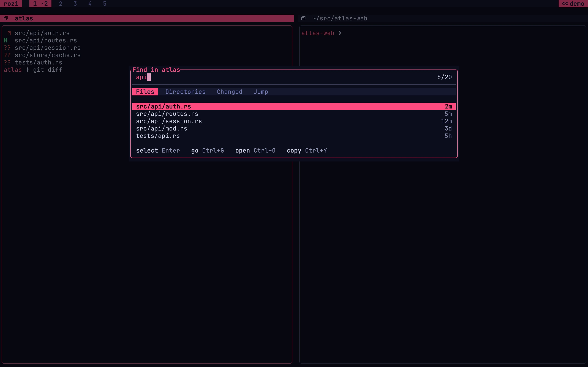

# rozi-finder

A picker for the files and directories around the pane you are in. Find a path by typing part of
it, then type it into the pane, `cd` to it, open it, or copy it. It works the same whatever runs
in the pane: a shell, an editor, or a coding agent's prompt.



## Requirements

- rozi 0.0.46 or newer
- Python 3.10 or newer, available as `python3`
- Linux or macOS
- Optional: `git`, to list a repository; [zoxide](https://github.com/ajeetdsouza/zoxide), for the
  Jump tab; `wl-copy`, `xclip`, `xsel`, or `pbcopy`, to copy a path

## Install

From rozi's **Extensions…** palette entry, open the **Discover** tab and install `finder`. Or use
the CLI:

```bash
rozi extensions install https://github.com/tui-lipan/rozi-finder.git
rozi run-action reload-extensions
```

Later releases can be applied with `rozi extensions update finder`.

## Use

Press `Ctrl+A`, then `x`, then `f`, or choose **Find files…** in the command palette. Type to
filter, and switch tabs with `Tab` and `Shift+Tab`.

| Tab | Lists |
| --- | --- |
| **Files** | Every file in the Git repository the pane is in, most recently changed first, with how long ago it changed. Ignored files are left out; untracked ones are listed. |
| **Directories** | The repository's directories, ordered by the newest file anywhere under each. `.` is the repository itself. |
| **Changed** | What `git status` reports, grouped as Conflicts, Changed, Staged, and Untracked. |
| **Jump** | Directories elsewhere: where the session's other panes are, then zoxide's directories, most used first. |

Outside a Git repository, Files and Directories list the pane's directory, nearest entries first,
up to 50,000 of them, and Changed is empty.

| Key | Action |
| --- | --- |
| `Enter` | Type the path into the pane, quoted for a shell and followed by a space, without pressing `Enter`. On the Jump tab, go there instead. |
| `Ctrl+G` | Go there: `cd` to the directory, or to a file's directory. See [Going to a directory](#going-to-a-directory). |
| `Ctrl+O` | Open: a file in your editor, a directory as a shell, each in a new pane. |
| `Ctrl+Y` | Copy the absolute path. |
| `Ctrl+F` | Search every entry. Shown only for a large tree on an older rozi; see [Large trees](#large-trees). |
| `Esc` | Close the picker. |

A typed path is relative to the pane's directory when it is inside the pane's directory or
repository, and absolute otherwise.

Each tab also has its own command, which opens the picker on that tab:

| Command | ID |
| --- | --- |
| **Find files…** | `finder.files` |
| **Find directories…** | `finder.dirs` |
| **Find changed files…** | `finder.changed` |
| **Jump to directory…** | `finder.jump` |

Bind any of them in `config.toml`; see rozi's
[keybindings](https://rozi.tui-lipan.dev/keybindings) for how keys are written:

```toml
[keys]
"finder.files" = "alt-p"
"finder.jump" = "alt-z"
```

### Going to a directory

Going there runs `cd` in the pane only when the pane's shell is waiting at its prompt: `sh`,
`bash`, `zsh`, `fish`, `dash`, `ksh`, `mksh`, or `ash`. The command is typed after anything already
on the prompt line, so start from an empty one.

When anything else runs in the pane, such as an editor, an agent, or a shell this extension cannot
quote for, nothing is typed into it. A new pane opens in that directory instead.

### Large trees

A rozi picker holds 512 rows, so in a tree with more entries each tab starts with the 512 most
recently changed. As you type, the tab is refilled with the best matches from the whole tree:
names that contain every word you typed come first, then paths that do, then paths that contain
the letters in order.

That needs a rozi whose `rozi api describe` lists `pick-query-events`. On an older rozi, typing
filters only the 512 rows shown. To reach the rest there, type what you are looking for and press
`Ctrl+F`, then `Enter`; search with an empty field to get the recent entries back.

## Settings

Set these under `[extensions.finder]` in `config.toml`:

| Setting | Default | Meaning |
| --- | --- | --- |
| `root` | `"repository"` | `"repository"` lists the whole Git repository the pane is in. `"directory"` lists only the pane's directory. |
| `hidden` | `false` | Outside a Git repository, also list entries whose names start with a dot. Inside one, they are listed whenever Git lists them. |
| `editor` | `""` | Command `Ctrl+O` opens a file with, such as `"nvim"` or `"code -w"`. Empty uses `$VISUAL`, then `$EDITOR`. |

## Limits

- The picker lists the machine the rozi client runs on. In a session attached with `--remote`, it
  does not list the remote host's files.
- One path at a time: the picker has no multiple selection.
- A file that has been deleted but not committed appears on the Changed tab only.

## Development

```bash
python3 -m unittest discover tests -p 'test_*.py'
rozi extensions check .
rozi extensions install --link .
```

The gallery screenshot is captured from `docs/screenshot-scene.sh` with rozi's
`rozi-extension` screenshot script and `--config docs/screenshot-config.toml`.

## License

[MPL-2.0](LICENSE)
